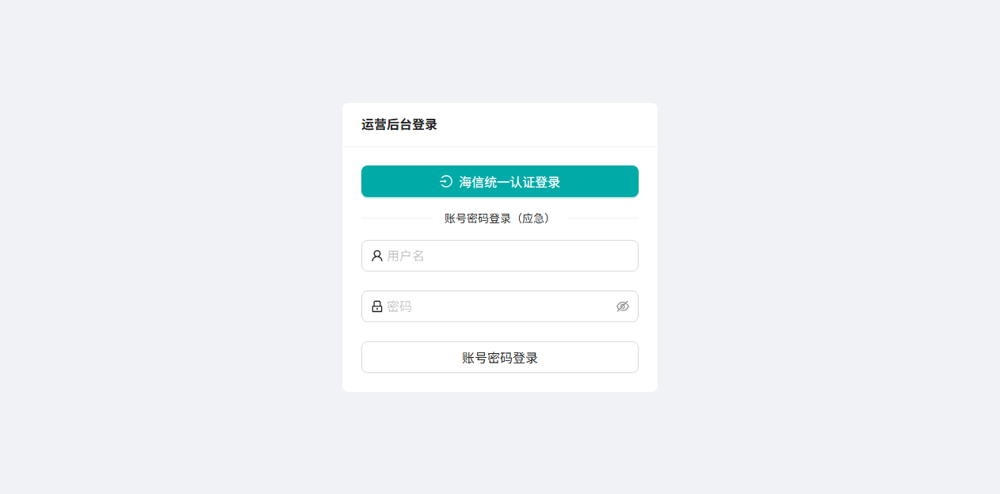
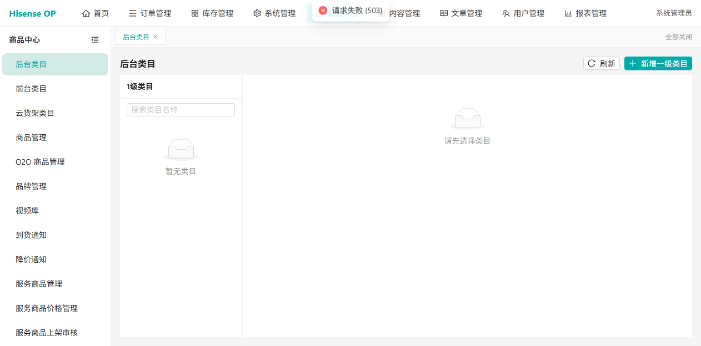

# Dogfood 报告：海信商城新运营后台（admin-new）

| 字段 | 值 |
|------|----|
| 日期 | 2026-10-14 |
| 应用 URL | http://hisenseop.xyftest.hisense.com/ |
| Session | dogfood-new |
| 范围 | 登录 + 订单管理（订单列表）+ 商品中心（后台类目） |
| 登录账号 | admin（密码见 _CREDENTIALS.md，不回显） |

## 说明

新运营后台（“Hisense OP”）相比旧后台界面更现代：顶部横向主菜单（首页/订单管理/库存管理/系统管理/商品中心/内容管理/文章管理/用户管理/报表管理），左侧为当前模块的子菜单，内容区为前端路由页面。本轮覆盖登录、订单列表、商品中心三处，发现 1 个明确缺陷。

## 汇总

| 严重度 | 数量 |
|--------|------|
| critical | 0 |
| high | 1 |
| medium | 0 |
| low | 1 |
| 总计 | 2 |

## 已验证的正向结果

- 登录正常：登录页提供“海信统一认证登录 / 账号密码登录”两种方式。用 admin 账号密码登录后成功进入后台，标题“海信商城运营后台”。证据：screenshots/00-login.png。
- 订单管理（订单列表）正常：默认落地页加载出完整订单数据，含订单号、下单时间、买家、商品信息、价格、数量、物流信息、交易状态（待发货/申请售后/超时关闭/已取消等），顶部有状态筛选页签（所有订单/待付款/待发货/待收货/已完成）与按订单号/买家ID/手机号的筛选，分页显示“共422612条”。证据：screenshots/01-landing.png。

## Issues

### ISSUE-N1: 商品中心“后台类目”加载失败（接口 503）

| 字段 | 值 |
|------|----|
| 严重度 | high |
| 类别 | functional / console |
| URL | http://hisenseop.xyftest.hisense.com/product/categories |
| 复现视频 | N/A（静态可见） |

**描述**

从顶部菜单进入“商品中心”，默认打开“后台类目”页。页面顶部弹出红色错误提示“请求失败 (503)”；左侧“1级类目”区显示“暂无类目”，右侧显示“请先选择类目”。类目数据完全未加载，页面功能不可用。

**技术证据**

- 页面 errors 捕获到：`AxiosError: Request failed with status code 503`，调用链为 `productApi.js` 的 `categories` 接口 → `index.js` 的请求封装。即商品类目列表接口返回 HTTP 503（服务不可用）。
- UI 层面：顶部 toast “请求失败 (503)”，类目列表为空。

**复现步骤**

1. 登录新后台
   
2. 点击顶部菜单“商品中心”，默认进入“后台类目”
   
3. 观察：顶部提示“请求失败 (503)”，1级类目“暂无类目”，右侧“请先选择类目”

**影响**

后台类目是商品体系的基础配置入口，类目接口 503 会导致该页不可用，并可能连带影响依赖类目的其他商品功能。建议优先排查该接口服务状态。

---

### ISSUE-N2: 登录成功后跳转落地页与 redirect 参数不一致

| 字段 | 值 |
|------|----|
| 严重度 | low |
| 类别 | functional / ux |
| URL | http://hisenseop.xyftest.hisense.com/login?redirect=%2Fhome → /order/orders |
| 复现视频 | N/A |

**描述**

登录页 URL 带 `redirect=%2Fhome`（即期望登录后跳转 /home），但实际登录成功后落地在 `/order/orders`（订单列表），而非 /home。属轻微的跳转逻辑/参数不一致问题，不影响使用（订单列表为常用页），但 redirect 参数未被遵循。

**证据**

- 登录地址 redirect=%2Fhome；登录后 get url = `http://hisenseop.xyftest.hisense.com/order/orders`

---

## 证据文件

- screenshots/00-login.png — 登录页（两种登录方式）
- screenshots/01-landing.png — 登录后落地的订单列表（标注截图）
- screenshots/02-product-center.png — 商品中心“后台类目”页，顶部“请求失败 (503)”
- auth-state.json — 已保存登录态，便于后续复测免重复登录

## 后续建议

1. 优先排查 ISSUE-N1：商品类目接口（productApi.categories）返回 503 的服务端原因，确认是环境问题还是接口缺陷。
2. 分批继续探索其余顶部模块的叶子功能：库存管理、系统管理、内容管理、文章管理、用户管理、报表管理，每页检查列表加载、筛选、分页、空状态与 console 报错。
3. ISSUE-N2：确认登录成功后的落地页策略，是否应遵循 redirect 参数跳转 /home。
