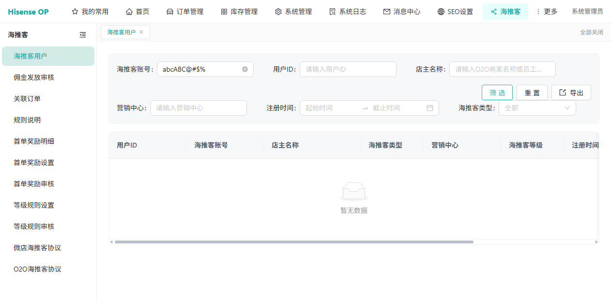
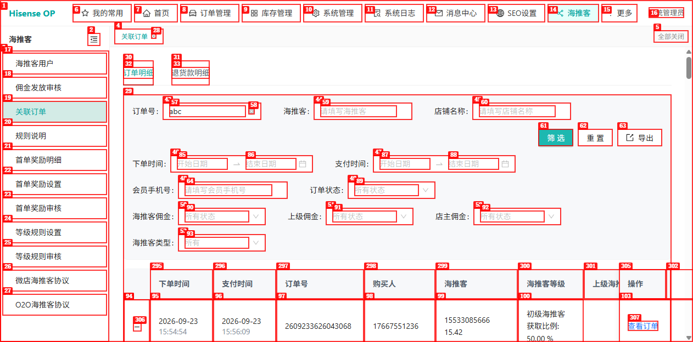
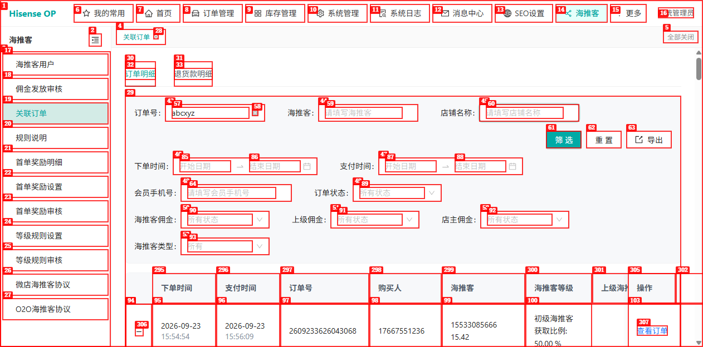
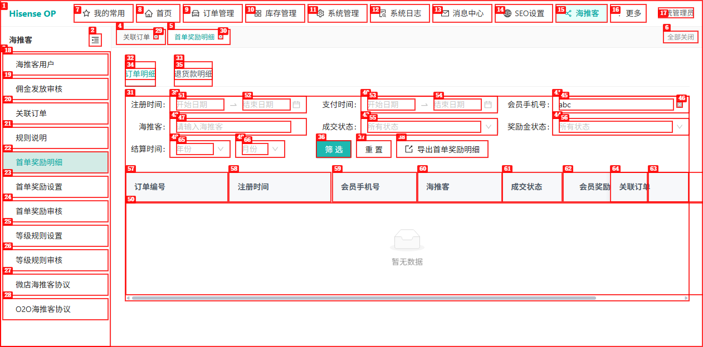
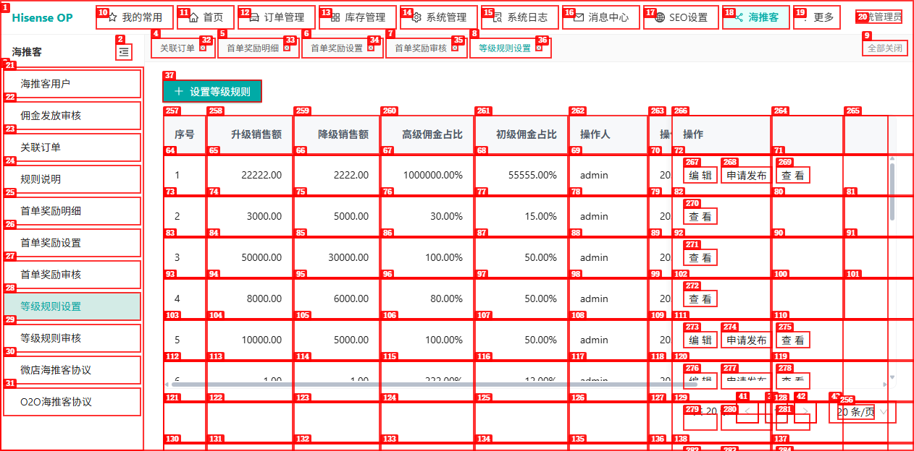

# Dogfood 深度探索报告：海推客（admin-new 新运营后台）

| 字段 | 值 |
|------|-----|
| 日期 | 2026-10-21 |
| 应用 URL | http://hisenseop.xyftest.hisense.com （海推客模块，顶部主菜单「海推客」，/retail/*） |
| 会话 | haitui-new |
| 账号 | admin（最高权限，测试环境；密码不回显） |
| 范围 | 海推客 11 个子菜单的深度探索（交互/边界/异常/一致性/控制台与网络） |
| 授权 | 用户明确授权：海推客模块审核/发放类状态流转可直接真跑（变更前后截图留证） |
| 方式 | dogfood repro-first，分批执行（6 批），每发现一个 issue 立即增量落盘 |

## 环境确认

- admin-new 新后台（Hisense OP）顶部主菜单含独立「海推客」项；左侧 11 子菜单：海推客用户、佣金发放审核、关联订单、规则说明、首单奖励明细、首单奖励设置、首单奖励审核、等级规则设置、等级规则审核、微店海推客协议、O2O海推客协议。
- 与同域名旧界面的 `/retail/*` 为同一套系统，故本轮聚焦前轮未深挖的交互/边界/异常路径，复核已知缺陷是否仍存在。

## 摘要

| 严重级别 | 数量 |
|----------|------|
| Critical | 0 |
| High | 0 |
| Medium | 1 |
| Low | 3 |
| **合计** | **4** |

（探索完成）

## 批次进度

- [x] 批次 1 — 海推客用户 /retail/retailers（类型筛选✅生效 / 重置✅ / 导出✅ / 右侧列渲染✅正常，无前轮ISSUE-001缺陷 / 控制台✅无错误；发现 ISSUE-001 账号框无格式校验）
- [x] 批次 2 — 关联订单 /retail/orders（订单明细/退货款明细双Tab✅ / 筛选✅ / 导出✅ / 查看订单/退款单✅ / 控制台✅无错误；发现 ISSUE-002 订单号/会员手机号无格式校验）
- [x] 批次 3 — 首单奖励明细 /retail/first-order-rewards（订单明细/退货款明细双Tab✅ / 筛选✅ / 导出✅ / 查看订单明细✅ / 控制台✅无错误；发现 ISSUE-003 会员手机号无格式校验）
- [x] 批次 4 — 首单奖励设置 + 审核 /retail/first-order-reward-configs + /retail/first-order-reward-config-audits（设置页✅ / 审核页✅ / 状态流转✅ / 控制台✅无错误；无新问题）
- [x] 批次 5 — 等级规则设置 + 审核 /retail/rank-configs（设置页✅ / 控制台✅无错误；发现 ISSUE-004 佣金占比数据异常）
- [x] 批次 6 — 规则说明 + 协议 /retail/rule-desc + /retail/protocol-ec + /retail/protocol-o2o（规则说明页✅ / 协议页✅ / 控制台✅无错误；无新问题）

## Issues

<!-- 每发现一个问题立即追加一个 ### ISSUE-NNN 块 -->

### ISSUE-001：海推客用户「海推客账号」筛选框无手机号格式校验（接受字母/特殊字符）

| 字段 | 值 |
|------|-----|
| 严重级别 | low |
| 分类 | functional / ux |
| URL | /retail/retailers |
| Repro Video | N/A（静态，填入即现） |

**描述**

海推客用户列表的「海推客账号」筛选框 placeholder 明确为"请输入海推客手机号"，但输入框**无任何前端格式校验**：填入纯字母+特殊字符 `abcABC@#$%` 后点「筛选」被直接接受并提交，页面不给出任何格式错误提示，后端返回空结果（"暂无数据"）。手机号字段理应限制为数字且做长度/格式校验，否则用户输错时得不到有效反馈，也增加无意义的后端查询。

**Repro Steps**

1. 进入 海推客 / 海推客用户（/retail/retailers）
2. 在「海推客账号」框填入 `abcABC@#$%`，点「筛选」
   
3. **观察**：无格式校验提示，直接提交，列表显示"暂无数据"

**备注**：空状态文案"暂无数据"表现正常；此为输入校验缺失（防呆），与前轮用户模块"会员手机号无前端格式校验"同类。严重级别 low。类型下拉筛选经验证**生效**（选「微店海推客」后列表全部为微店类型、总数 210→61，见 screenshots/b1-06-type-wd-filtered.png），导出功能正常（跳转导入导出中心，见 b1-07-export.png），表格右侧列横向滚动渲染正常（b1-08-scroll-right.png），均无缺陷。

### ISSUE-002：关联订单「订单号」「会员手机号」筛选框无格式校验（接受非数字输入）

| 字段 | 值 |
|------|-----|
| 严重级别 | low |
| 分类 | functional / ux |
| URL | /retail/orders |
| Repro Video | N/A（静态，填入即现） |

**描述**

关联订单列表的「订单号」和「会员手机号」筛选框均无前端格式校验：订单号框接受字母 `abc`，会员手机号框接受字母 `xyz`，点「筛选」后被直接提交，无任何格式错误提示。订单号应为纯数字，手机号应为11位数字，缺少格式校验导致用户输错时无反馈，增加无意义后端查询。

**Repro Steps**

1. 进入 海推客 / 关联订单（/retail/orders）
2. 在「订单号」框填入 `abc`，点「筛选」
   
3. 在「会员手机号」框填入 `xyz`，点「筛选」
   
4. **观察**：均无格式校验提示，直接提交

**备注**：此为防呆设计缺失，与 ISSUE-001 同类。控制台无 JS 错误。重置、导出、Tab切换（订单明细/退货款明细）、查看订单/退款单链接均正常。

### ISSUE-003：首单奖励明细「会员手机号」筛选框无格式校验（接受非数字输入）

| 字段 | 值 |
|------|-----|
| 严重级别 | low |
| 分类 | functional / ux |
| URL | /retail/first-order-rewards |
| Repro Video | N/A（静态，填入即现） |

**描述**

首单奖励明细列表的「会员手机号」筛选框无前端格式校验，接受字母 `abc` 并直接提交，无格式错误提示。与 ISSUE-001、ISSUE-002 同类。

**Repro Steps**

1. 进入 海推客 / 首单奖励明细（/retail/first-order-rewards）
2. 在「会员手机号」框填入 `abc`，点「筛选」
   
3. **观察**：无格式校验提示，直接提交

**备注**：控制台无 JS 错误。订单明细/退货款明细Tab切换、筛选、导出、查看订单明细链接均正常。

### ISSUE-004：等级规则设置存在佣金占比超 100% 的异常数据（1000000.00%、55555.00%）

| 字段 | 值 |
|------|-----|
| 严重级别 | medium |
| 分类 | data / business-logic |
| URL | /retail/rank-configs |
| Repro Video | N/A（静态，列表可见） |

**描述**

等级规则设置列表中存在异常数据：序号 1 的规则「高级佣金占比」为 `1000000.00%`，「初级佣金占比」为 `55555.00%`，远超合理范围（通常佣金占比应 ≤ 100%）。如果这是系统允许的输入，则业务逻辑存在问题；如果是脏数据，则缺少输入范围校验。需确认业务规则。

**Repro Steps**

1. 进入 海推客 / 等级规则设置（/retail/rank-configs）
2. 查看序号 1 的规则数据
   
3. **观察**：高级佣金占比 1000000.00%，初级佣金占比 55555.00%

**备注**：该规则状态为「未发布」，审核状态列为空。其他规则占比在 0-300% 范围内，部分也超过 100%（如 180%、200%、300%），需确认业务是否允许占比超过 100%。如果占比含义为「佣金占销售额的比例」，则应限制在 100% 以内；如果含义不同，则需明确上限并增加前端校验。
