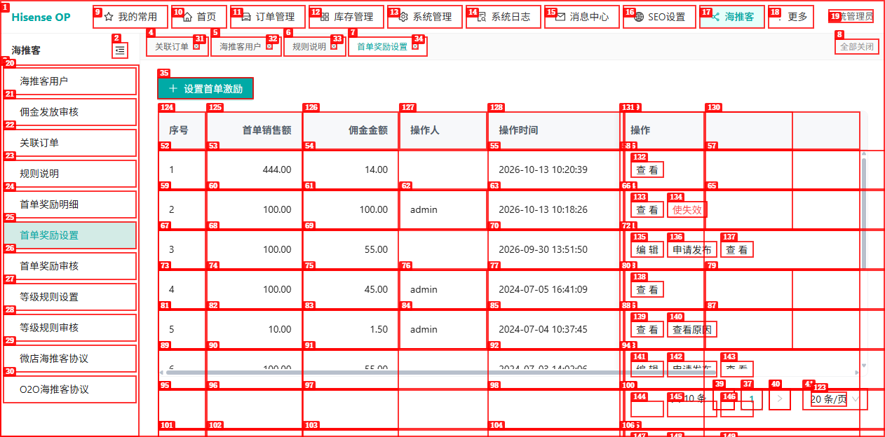
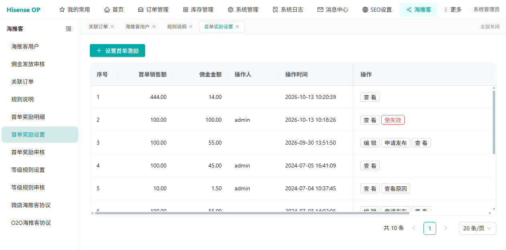
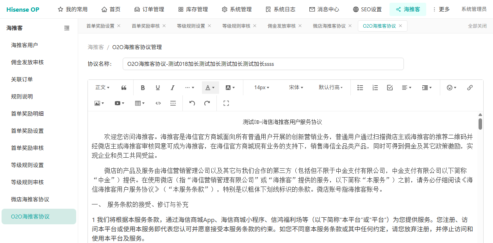

# Dogfood 报告：海推客（新运营后台）

| 字段 | 值 |
|------|-----|
| 日期 | 2026-10-21 |
| 应用 URL | http://hisenseop.xyftest.hisense.com （海推客模块 /retail/*） |
| 会话 | haitui |
| 范围 | 海推客全部 11 个子模块（海推客用户、佣金发放审核、关联订单、规则说明、首单奖励明细、首单奖励设置、首单奖励审核、等级规则设置、等级规则审核、微店海推客协议、O2O海推客协议） |
| 账号 | admin（最高权限，测试环境） |
| 方式 | dogfood 探索式测试（systematic），按 issue-taxonomy 分类，repro-first 取证 |

## 摘要

| 严重级别 | 数量 |
|----------|------|
| Critical | 0 |
| High | 0 |
| Medium | 1 |
| Low | 1 |
| **合计** | **2** |

### 核心结论

- **ISSUE-001（medium，系统性布局缺陷）**：海推客模块**至少 5 个列表页**（首单奖励设置/审核、等级规则设置/审核、佣金发放审核）在默认视口下**右侧多列塌缩不渲染**——状态/审核状态、创建时间/审核时间/审核人/驳回原因等关键列看不到，数据列与表头错位、"操作"列前出现大片空白。数据在 DOM 中存在、仅未渲染。这是本次最重要的发现，覆盖面广，建议优先修复列表组件的列宽/列渲染逻辑。
- **ISSUE-002（low，内容待确认）**：O2O 协议正文误用微店文案，疑似测试数据，待运营核实。
- **其余 6 个页面**（海推客用户、关联订单、首单奖励明细、规则说明、微店协议、O2O协议布局）视觉与控制台均正常。全模块 11 页**无 JavaScript 控制台错误**。
- **附带观察**：等级规则历史数据存在占比>100%、升级额<降级额等突破校验规则的记录（见 ISSUE-001 附注），建议结合边界/逻辑校验用例核实新增时是否有校验。
- 规则说明页图片上传限制文案明确为"小于5M的 JPG/PNG/GIF"，可用于补全 CSV GZSM 的【待确认】项。

### 与 CSV 用例批次的功能缺陷互为补充

CSV 批次（haitui-v2 报告）已发现的功能缺陷在此并列，便于一并交付开发：
- 首单奖励明细：成交状态、奖励金状态下拉筛选疑似不生效（SDJLMX-006/007）
- 关联订单：订单号非法格式不过滤返回全量（GLDD-002）
- 首单奖励明细：会员手机号无前端格式校验（SDJLMX-002）、脱敏号在跳转 URL 暴露完整号

## 探索覆盖进度（11/11 全部走遍）

- [x] 海推客用户 /retail/retailers — 布局正常，无控制台错误
- [x] 佣金发放审核 /retail/commission-audits — **命中 ISSUE-001**（右侧多列塌缩）
- [x] 关联订单 /retail/orders — 已在 CSV 批次深度测过
- [x] 规则说明 /retail/rule-desc — 布局正常；图片限制文案明确"小于5M的JPG/PNG/GIF"
- [x] 首单奖励明细 /retail/first-order-rewards — 已在 CSV 批次深度测过
- [x] 首单奖励设置 /retail/first-order-reward-configs — **ISSUE-001 源发现**；空值校验正常
- [x] 首单奖励审核 /retail/first-order-reward-config-audits — **命中 ISSUE-001**
- [x] 等级规则设置 /retail/rank-configs — **命中 ISSUE-001**；占比脏数据
- [x] 等级规则审核 /retail/rank-config-audits — **命中 ISSUE-001**；逻辑脏数据
- [x] 微店海推客协议 /retail/protocol-ec — 布局正常，富文本编辑器完整
- [x] O2O海推客协议 /retail/protocol-o2o — 布局正常；**命中 ISSUE-002**（正文误用微店文案）

## Issues

<!-- 每发现一个问题立即追加一个 ### ISSUE-NNN 块 -->

### ISSUE-001：首单奖励设置列表"状态""审核状态"两列不渲染（表格布局缺陷）

| 字段 | 值 |
|------|-----|
| 严重级别 | medium |
| 分类 | visual / functional |
| URL | /retail/first-order-reward-configs |
| Repro Video | N/A（加载即现，静态问题） |

**描述**

首单奖励设置列表，表头在 DOM 中共 8 列（序号、首单销售额、佣金金额、操作人、操作时间、**状态**、**审核状态**、操作），但页面实际只渲染出 6 列可见——"**状态**"和"**审核状态**"两列在默认视口下完全不显示，"操作时间"列与"操作"列之间出现一大片空白。用户在列表上**看不到每条规则的状态（未发布/进行中/已失效）和审核状态（待审核/审核通过/审核不通过）**，这两个是该列表的关键业务字段。

数据本身存在（snapshot 读到 e56="未发布"、e57="待审核"、e64="进行中"、e65="审核通过"等），只是未在页面渲染。属于前端表格列宽/列显示的布局缺陷。

**Repro Steps**

1. 进入 海推客 / 首单奖励设置（/retail/first-order-reward-configs）
   

2. **观察**：表头与数据列错位，"操作时间"右侧直接是"操作"按钮，中间大片空白；"状态""审核状态"两列缺失
   

**备注**：无控制台错误。该缺陷导致用户必须点进"查看"才能确认规则状态，影响列表可用性。

**影响范围（已确认为通用缺陷）**：同样的"状态/审核状态列不渲染、列错位"问题在以下页面全部复现，确认是**规则类列表组件的通用布局缺陷**：
- 首单奖励设置 /retail/first-order-reward-configs（screenshots/03b-reward-setting-scrolled.png）
- 首单奖励审核 /retail/first-order-reward-config-audits（screenshots/05-reward-audit.png）
- 等级规则设置 /retail/rank-configs（screenshots/06-grade-setting.png，"状态/审核状态"两列缺失，"操作时间"被挤成"操"）

因"状态/审核状态"是规则管理的核心字段、4+ 个列表页均不可见，影响面广，严重级别按 **medium 偏高** 处理，建议优先修复该列表组件的列宽/列渲染逻辑。

**附带观察（非本 issue）**：等级规则设置页序号4"高级佣金占比 222.00%"、等级规则审核页序号4"初级佣金占比 345.00%、升级销售额 12 < 降级销售额 123"（截图 06/07）均突破 CSV 规定的占比≤100% 和升级>降级逻辑。可能是历史脏数据，也可能提示新增校验缺失，建议结合 DJGZSZ-004/005 边界与逻辑校验用例核实。

**影响范围再扩大 — 不止规则类组件**：佣金发放审核页（/retail/commission-audits，带筛选的任务列表，非规则组件）同样出现右侧多列被挤压/不渲染：表头"创建时间"被挤成"创"，"创建时间/审核时间/审核人/驳回原因"四列数据在默认视口不可见，"汇总金额"后直接跳到"操作"列、中间大片空白（截图 screenshots/08-commission-audit.png）。说明这是**海推客模块多个列表页的系统性布局缺陷**（列多时右侧列塌缩），覆盖规则类与任务类两种列表。建议作为该后台列表组件的通用问题统一排查修复。

### ISSUE-002：O2O海推客协议正文误用"微店"文案（内容张冠李戴）

| 字段 | 值 |
|------|-----|
| 严重级别 | low（内容） |
| 分类 | content |
| URL | /retail/protocol-o2o |
| Repro Video | N/A（加载即现） |

**描述**

O2O海推客协议页，正文标题为"测试0B-海信海推客用户服务协议"，但正文内容通篇使用"**微店**"的措辞——"**微店**的产品及服务由海信营销管理公司...在使用**微店**（指...）...之前，请务必仔细阅读《海信海推客用户服务协议》"，与微店海推客协议页（/retail/protocol-ec）的正文几乎完全一致。O2O 协议理应描述 O2O 店的服务条款，却套用了微店文案。

**Repro Steps**

1. 进入 海推客 / O2O海推客协议（/retail/protocol-o2o）
   

2. **观察**：正文反复出现"微店"，与微店协议页（screenshots/09-wd-agreement.png）文案雷同

**备注**：协议正文为运营可编辑内容，**不排除是测试环境里人工把微店文案粘贴进 O2O 协议所致**（协议名也带"测试01B加长测试"字样）。建议运营核实 O2O 协议正文是否应使用 O2O 专属文案，而非产品代码缺陷。标记为待确认。